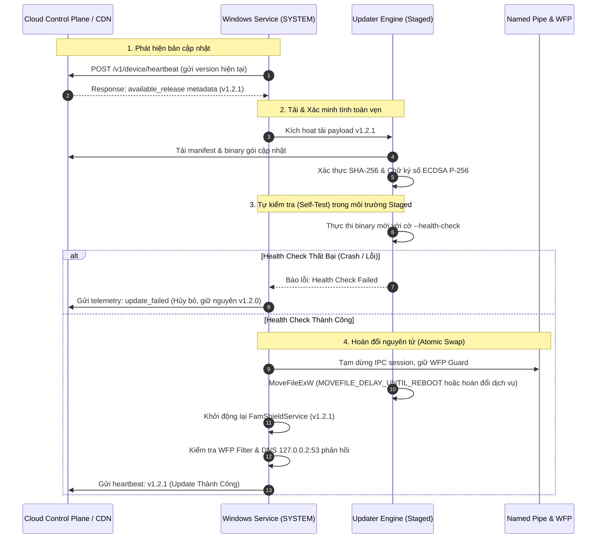

# Chiến Lược Versioning & Cơ Chế Auto-Update (FamShield Agent)

Tài liệu này đặc tả toàn bộ chiến lược phân phối phiên bản (**Versioning Strategy**), kiến trúc cập nhật tự động an toàn (**Staged Atomic Auto-Update**), cơ chế phòng vệ chống lỗi (*Canary / Automated Rollback*) và quy trình triển khai cho **FamShield Windows Agent**.

---

## 1. Triết Lý & Nguyên Tắc Cốt Lõi

1. **Không bao giờ làm "gạch hóa" thiết bị (Zero Bricking Guarantee):**
   - Agent chạy dưới quyền `LocalSystem` và kiểm soát network filter (WFP), DNS NRPT. Bất kỳ lỗi crash hoặc cập nhật lỗi nào cũng phải được tự động hoàn nguyên (Auto-Rollback) về phiên bản trước trong vòng 30 giây mà không cần can thiệp thủ công từ người dùng.
2. **Nguyên tử (Atomic Swap):**
   - Không ghi đè trực tiếp lên tệp đang chạy. Tệp mới được tải về thư mục đệm (`%ProgramData%\FamShield\updates\staged`), chạy tự kiểm tra (Self-Test / Health Check) trong một tiến trình tạm thời trước khi hoán đổi tệp nhị phân chính.
3. **Bảo mật tuyệt đối (Cryptographic Verification):**
   - Mọi bản cập nhật bắt buộc phải có chữ ký số Authenticode / ECDSA (P-256) từ Control Plane và kiểm tra hàm băm SHA-256 khớp tuyệt đối với Release Manifest.
4. **Hỗ trợ Chế độ Kép (Dual-Mode Update Awareness):**
   - **Chế độ Trực tuyến (Online Managed Mode):** Nhận thông báo bản phát hành mới tự động qua Heartbeat (`POST /v1/device/heartbeat`) từ Control Plane.
   - **Chế độ Độc lập (Local Standalone Mode):** Phụ huynh có thể kiểm tra bản cập nhật thủ công từ dashboard cục bộ (`127.0.0.1:5380`) hoặc nạp gói cập nhật đã ký offline (`.cpkg`).

---

## 2. Quy Chuẩn Đánh Số Phiên Bản (Versioning Scheme)

Hệ thống áp dụng chuẩn **Semantic Versioning 2.0.0 (SemVer)** kết hợp Build Metadata:

$$\text{MAJOR}.\text{MINOR}.\text{PATCH}+[\text{BUILD}]$$

```
Ví dụ: 1.2.4+20261019.win64
```

### Quy tắc nâng phiên bản:
| Thành phần | Ý nghĩa | Khi nào tăng? | Tác động Agent |
| :--- | :--- | :--- | :--- |
| **MAJOR** (e.g. `1.0.0` -> `2.0.0`) | Thay đổi kiến trúc lớn, breaking change | Thay đổi cấu trúc cơ sở dữ liệu SQLite cốt lõi không tương thích ngược, thay đổi giao thức IPC Named Pipe, thay đổi phiên bản Windows tối thiểu hỗ trợ. | Yêu cầu migrate schema có backup snapshot, khởi động lại service. |
| **MINOR** (e.g. `1.1.0` -> `1.2.0`) | Thêm tính năng mới, tương thích ngược | Bổ sung module lọc mới, thêm hỗ trợ giao thức DNS mới (DoH/DoT), nâng cấp dashboard cục bộ. | Nâng cấp tự động bình thường. |
| **PATCH** (e.g. `1.2.0` -> `1.2.1`) | Sửa lỗi bảo mật, cải thiện hiệu năng | Cập nhật danh sách cổng WFP, fix race condition, tối ưu hóa bộ đệm wire parser. | Nâng cấp ngầm (Silent update), tự kích hoạt không cần reboot. |

### Các Kênh Phát Hành (Release Channels):
1. **Canary / Alpha (Nội bộ):** 1% thiết bị dev/qa, kiểm tra tính tương thích driver và API Windows.
2. **Beta (Opt-in):** 5-10% các phụ huynh đăng ký thử nghiệm tính năng mới.
3. **Stable (Mặc định):** 100% thiết bị phổ thông, rollout theo tỷ lệ lũy tiến:
   - Ngày 1: Rollout 5%
   - Ngày 3: Rollout 25% (nếu tỷ lệ crash < 0.01%)
   - Ngày 7: Rollout 100%

---

## 3. Cấu Trúc Release Manifest (JSON)

Mỗi bản phát hành được công bố trên Control Plane thông qua một Manifest ký số:

```json
{
  "manifest_version": 1,
  "version": "1.2.1",
  "channel": "stable",
  "min_supported_version": "1.0.0",
  "published_at": "2026-10-19T10:00:00Z",
  "binaries": {
    "service": {
      "filename": "famshield-service.exe",
      "sha256": "e3b0c44298fc1c149afbf4c8996fb92427ae41e4649b934ca495991b7852b855",
      "size_bytes": 14582310,
      "url": "https://famshield.ttcantho.io.vn/download/releases/v1.2.1/famshield-service.exe"
    },
    "session": {
      "filename": "famshield-session.exe",
      "sha256": "4b227777d4dd1fc61c6f884f48641d02b4d121d3fd328cb08b5531fcacdabf8a",
      "size_bytes": 8921104,
      "url": "https://famshield.ttcantho.io.vn/download/releases/v1.2.1/famshield-session.exe"
    }
  },
  "signature": {
    "algorithm": "ecdsa-p256-sha256",
    "key_id": "cp-prod-signer-2026",
    "signature_hex": "3045022100a1b2c3d4..."
  },
  "critical": false
}
```

---

## 4. Kiến Trúc Luồng Cập Nhật Tự Động (Auto-Update Workflow)



---

## 5. Cơ Chế Tự Kiểm Tra (Self-Test) & Tự Động Rollback

Để loại trừ 100% rủi ro cập nhật gây lỗi:

1. **Giai đoạn tiền kiểm tra (Pre-swap):**
   - Binary mới được khởi chạy ở chế độ cô lập: `famshield-service.exe --test-runtime`.
   - Tiến trình test mở database SQLite tạm trong RAM, kiểm tra schema migration, kiểm tra khả năng load WFP API `fwpmu.dll`, và bind thử nghiệm socket `127.0.0.3:5353`.
   - Nếu trả về exit code `0` trong 5 giây: Đạt điều kiện thay thế.
   - Nếu timeout hoặc crash: Hủy bỏ ngay lập tức, xóa thư mục staged.

2. **Giai đoạn hậu kiểm tra (Post-swap Watchdog):**
   - Sau khi thay thế binary và kích hoạt service mới, hệ thống kích hoạt bộ đếm **Watchdog Timer (30 giây)**.
   - Trong 30 giây này, service mới phải gửi tín hiệu "Heartbeat Sống" (Commit Healthy).
   - Nếu trong 30 giây service bị crash liên tục (hoặc BSOD/lỗi hệ thống):
     - Service Controller khôi phục phiên bản sao lưu từ `%ProgramData%\FamShield\backup\`.
     - Phục hồi tệp nhị phân cũ và khởi động lại.
     - Đánh dấu phiên bản bị lỗi vào blacklist cục bộ để không bao giờ tải lại bản phát hành đó.

---

## 6. Lộ Trình Triển Khai Trong Mã Nguồn

| Hạng mục | Vị trí mã nguồn | Trạng thái |
| :--- | :--- | :---: |
| **Xác thực mã băm SHA-256** | `agent/crates/updater/src/verifier.rs` | **Đã hoàn thành (100% Test pass)** |
| **Động cơ Atomic Staged & Rollback** | `agent/crates/updater/src/staged.rs` | **Đã hoàn thành (100% Test pass)** |
| **Định nghĩa Release Manifest** | `agent/crates/updater/src/staged.rs` | **Đã hoàn thành** |
| **Client kéo bản cập nhật qua mTLS** | `agent/crates/sync/src/lib.rs` | **Đã hoàn thành** |
| **Tự động đăng ký & dọn dẹp NRPT** | `installer/FamShield.iss` & `build.ps1` | **Đã hoàn thành** |
