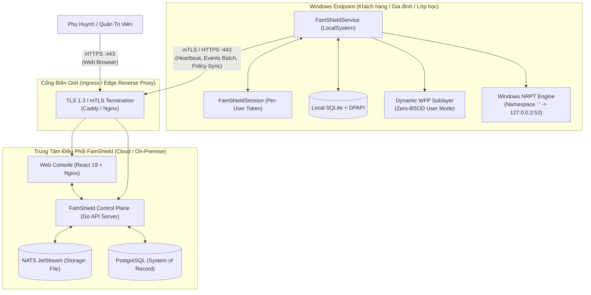
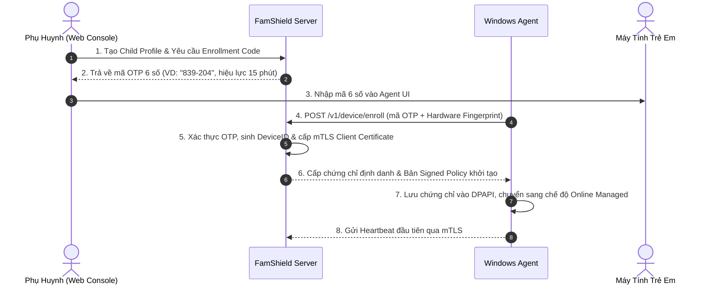

# Tài Liệu và Phương Án Triển Khai Hệ Thống FamShield (Deployment Guide)

Tài liệu này cung cấp phương án kiến trúc, quy trình chuẩn bị và hướng dẫn từng bước để triển khai nền tảng **FamShield Parental Control & Endpoint Protection** trên cả hai môi trường:
1. **Endpoint Windows Agent**: Máy trạm Windows của trẻ em / học sinh (Local Standalone hoặc Online Managed).
2. **Control Plane & Cloud Infrastructure**: Máy chủ điều phối trung tâm, Event Streaming (NATS JetStream), cơ sở dữ liệu và Web Console.

---

## 1. Kiến Trúc Triển Khai Tổng Thể (Architecture Overview)



### Đặc tính cốt lõi trong triển khai:
- **Dual-Mode Operation:** 
  - **Local Mode (Zero-Cloud):** Hoạt động độc lập không cần internet/server. Thiết lập qua PIN/Master Password và lưu trữ tại local SQLite.
  - **Online Mode (Cloud-Managed):** Thiết bị tự kết nối về máy chủ Go Control Plane thông qua mã OTP 6 số để nhận signed policy và đẩy batch sự kiện.
- **Anti-Bricking & Zero-Downtime:** 
  - Đăng ký bộ lọc mạng qua `FWPM_SESSION_FLAG_DYNAMIC` (tự giải phóng 100% drop rules nếu service dừng đột ngột).
  - Điều hướng DNS qua Windows NRPT vào loopback `127.0.0.2:53` mà không can thiệp hay đổi IP adapter vật lý.
  - Cập nhật phần mềm dạng atomic swap nhị phân kèm Watchdog 30s tự động rollback nếu service mới không thể khởi động.

---

## 2. Phần 1: Triển Khai Windows Agent (Endpoint Deployment)

### 2.1. Yêu Cầu Tiền Đề Hệ Thống
- **Hệ điều hành hỗ trợ:** Windows 10 (Version 1809 trở lên), Windows 11, Windows Server 2019 / 2022 / 2025 (x86_64).
- **Quyền hạn cài đặt:** Administrator (UAC elevation / Local Administrator).
- **Tài nguyên tối thiểu:** CPU 1 core, RAM 50MB khả dụng, Ổ cứng 150MB trống.
- **Mạng:** Cho phép kết nối outbound port `443` (HTTPS) tới tên miền Control Plane (nếu dùng Online Mode).

---

### 2.2. Phương Án 1: Triển Khai Tự Động / Developer qua PowerShell (`build.ps1`)

Phương án này phù hợp cho môi trường kiểm thử, tích hợp nội bộ và kỹ sư triển khai trực tiếp.

#### Các bước thực hiện:
1. Mở PowerShell với quyền **Run as Administrator**.
2. Di chuyển đến thư mục dự án và thực thi lệnh cài đặt:
   ```powershell
   # Biên dịch Release binaries và cài đặt Service + cấu hình NRPT
   .\build.ps1 install
   ```
3. Script sẽ tự động thực thi các hành động:
   - Biên dịch crate `famshield-service` và `famshield-session` ở chế độ tối ưu hóa cao nhất (`cargo build --release --bins`).
   - Copy nhị phân vào thư mục chuẩn hệ thống: `C:\Program Files\FamShield\`.
   - Tạo và kích hoạt Windows Service `FamShieldService` chạy dưới quyền `LocalSystem`, chế độ tự khởi động `Automatic`.
   - Cấu hình bảng phân giải tên miền Windows NRPT (`HKLM:\SOFTWARE\Policies\Microsoft\Windows NT\DnsClient\DnsPolicyConfig\{FamShield-DNS-Filter}`) điều hướng toàn bộ truy vấn `.` về `127.0.0.2:53`.

#### Kiểm tra trạng thái hoạt động:
```powershell
.\build.ps1 status
```
*Kết quả mẫu chuẩn:*
```text
--- FamShield Agent Status ---
Service 'FamShieldService': Running
NRPT DNS Route for namespace '.': 127.0.0.2
```

---

### 2.3. Phương Án 2: Đóng Gói Bộ Cài Đặt Inno Setup (`FamShieldSetup.exe`)

Phương án chuẩn cho việc phân phối rộng rãi tới phụ huynh (B2C) hoặc cài đặt hàng loạt trên máy tính cá nhân.

#### Biên dịch bộ cài đặt (CI/CD hoặc máy Build):
1. Cài đặt [Inno Setup 6+](https://jrsoftware.org/isdl.php).
2. Chạy lệnh đóng gói:
   ```powershell
   & "C:\Program Files (x86)\Inno Setup 6\ISCC.exe" installer\FamShield.iss
   ```
3. File setup được sinh ra tại: `installer\Output\FamShieldSetup-1.0.1.exe`.

#### Kịch bản cài đặt tương tác (GUI):
- Phụ huynh chạy `FamShieldSetup-1.0.1.exe` -> Nhấp "Install" -> Trình cài đặt tự động nạp binary, thiết lập Service và NRPT trong vòng 3 giây mà không yêu cầu khởi động lại máy.

#### Kịch bản cài đặt im lặng (Silent Install):
Dành cho IT Helpdesk hoặc phân phối từ xa:
```cmd
FamShieldSetup-1.0.1.exe /VERYSILENT /SUPPRESSMSGBOXES /NORESTART
```

---

### 2.4. Phương Án 3: Triển Khai Tập Trung Doanh Nghiệp (GPO / Intune MDM)

Áp dụng cho trường học, thư viện, hoặc gia đình có Active Directory Domain / Microsoft Intune.

#### Triển khai qua Active Directory Group Policy (GPO):
1. **Chia sẻ gói cài đặt:** Đặt `FamShieldSetup-1.0.1.exe` vào thư mục chia sẻ mạng `\\domain.local\netlogon\FamShield\`.
2. **Tạo GPO Startup Script (`install-famshield.bat`):**
   ```cmd
   @echo off
   if exist "C:\Program Files\FamShield\famshield-service.exe" goto END
   \\domain.local\netlogon\FamShield\FamShieldSetup-1.0.1.exe /VERYSILENT /SUPPRESSMSGBOXES /NORESTART
   :END
   ```
3. **Cấu hình Policy Enrollment (Tự động gán vào Cloud Tenant):**
   - Đặt giá trị Registry cho mã Token kích hoạt sẵn (Pre-enrolled Token):
     `HKLM\SOFTWARE\FamShield\EnrollmentToken = "ORG-ENROLL-XYZ789"`
   - Khi `FamShieldService` khởi động lần đầu, agent tự nhận diện Token và hoàn tất bắt tay mTLS với Control Plane.

---

## 3. Phần 2: Triển Khai Hạ Tầng Máy Chủ (Control Plane Infrastructure)

### 3.1. Phương Án 1: Triển Khai Nhanh qua Docker Compose (Single VPS / On-Premise)

Phù hợp cho máy chủ riêng gia đình, phòng LAB hoặc VPS quy mô nhỏ tới vừa (1 - 5,000 thiết bị).

Toàn bộ ngăn xếp (Full-Stack) bao gồm:
1. **NATS JetStream (`famshield-nats`)**: Message Streaming Engine siêu nhẹ (~20MB RAM, sub-millisecond latency, lưu trữ file bền vững).
2. **FamShield Control Plane (`famshield-control-plane`)**: Go API Server tĩnh siêu gọn (~15MB image, bảo mật distroless debian nonroot).
3. **Web Management Console (`famshield-web-console`)**: React 19 SPA chạy trên Nginx Alpine hiệu năng cao, tích hợp sẵn reverse proxy API.

#### Cấu trúc tệp `docker-compose.yml`:
```yaml
services:
  nats:
    image: nats:2.10-alpine
    container_name: famshield-nats
    restart: unless-stopped
    ports:
      - "4222:4222" # Port kết nối nội bộ
      - "8222:8222" # HTTP Web Monitor
    command: ["-js", "-sd", "/data"]
    volumes:
      - nats-data:/data

  control-plane:
    build:
      context: ./server
      dockerfile: Dockerfile
    container_name: famshield-control-plane
    restart: unless-stopped
    depends_on:
      - nats
    ports:
      - "8080:8080"
    environment:
      - PORT=8080
      - LOG_LEVEL=info
      - NATS_URL=nats://nats:4222
    healthcheck:
      test: ["CMD-SHELL", "wget -qO- http://localhost:8080/healthz || exit 1"]
      interval: 10s
      timeout: 3s
      retries: 3
      start_period: 5s

  web-console:
    build:
      context: ./web
      dockerfile: Dockerfile
    container_name: famshield-web-console
    restart: unless-stopped
    depends_on:
      - control-plane
    ports:
      - "3000:80"

volumes:
  nats-data:
```

#### Quy trình khởi chạy:
```bash
# 1. Clone repository
git clone https://github.com/org/famshield.git
cd famshield

# 2. Xây dựng và khởi chạy tất cả các containers
docker compose up -d --build

# 3. Kiểm tra nhật ký hoạt động
docker compose logs -f
```

- **Web Dashboard:** Truy cập `http://<ip-server>:3000`
- **NATS Dashboard:** Truy cập `http://<ip-server>:8222`
- **API Healthcheck:** `http://<ip-server>:8080/healthz`

---

### 3.2. Phương Án 2: Triển Khai Production Cloud Cấp Doanh Nghiệp (High Availability)

Áp dụng cho nhà cung cấp dịch vụ viễn thông, trường học lớn hoặc nền tảng SaaS phục vụ hàng triệu thiết bị.

#### Kiến trúc Reverse Proxy & Chứng Chỉ Bảo Mật (Caddy / Let's Encrypt):
Cấu hình mẫu `Caddyfile` tự động quản lý chứng chỉ SSL TLS 1.3 và mTLS cho thiết bị:

```caddyfile
# Cổng quản trị dành cho Phụ huynh
admin.famshield.cloud {
    reverse_proxy famshield-web-console:80
}

# Cổng API công khai và Webhook
api.famshield.cloud {
    reverse_proxy famshield-control-plane:8080
}

# Cổng mTLS chuyên dụng cho Agent Endpoint giao tiếp bảo mật
device.famshield.cloud {
    tls {
        client_auth {
            mode require_and_verify
            trusted_ca_cert_file /etc/ssl/famshield/device_ca.crt
        }
    }
    reverse_proxy famshield-control-plane:8080
}
```

#### Thiết lập CSDL PostgreSQL & Khả năng Phục hồi Thảm họa:
- Sử dụng PostgreSQL 16+ có cấu hình WAL Archiving hoặc Cloud Database (AWS RDS / GCP Cloud SQL).
- Cấu hình Connection Pool `max_open_conns=50`, `max_idle_conns=10`.
- Chạy Database Migration tuần tự trước khi cập nhật các phiên bản API mới (`server/cmd/migrate`).

---

## 4. Phần 3: Quy Trình Vận Hành & Thiết Lập Thiết Bị (Operational Runbooks)

### 4.1. Runbook 1: Quy Trình Khởi Tạo & Ghép Đôi Thiết Bị (Device Enrollment)



1. **Bước 1 (Trên Web Console):** Phụ huynh vào mục **Devices** -> Nhấp **"Enroll New Device"** -> Chọn hồ sơ con -> Nhận mã OTP 6 số (ví dụ: `839204`).
2. **Bước 2 (Trên Máy Tính Con):** Mở giao diện `famshield-session` hoặc dùng dòng lệnh:
   ```cmd
   "C:\Program Files\FamShield\famshield-session.exe" --enroll 839204
   ```
3. **Bước 3 (Xác nhận):** Ngay lập tức trên Web Console, trạng thái máy chuyển sang `Online (Green)` và hiển thị thông số CPU, RAM, phiên bản Windows.

---

### 4.2. Runbook 2: Vận Hành Ngoại Tuyến (Offline Local Mode)

Khi không có kết nối internet hoặc không muốn sử dụng dịch vụ đám mây:
1. Agent tự động hoạt động ở **Local Standalone Mode**.
2. Phụ huynh mở giao diện quản trị cục bộ bằng Master PIN:
   - Toàn bộ luật lọc danh mục web (Porn, Gambling, Malware, Games) được thực thi trực tiếp trên máy thông qua tập luật SQLite nội bộ.
   - Thống kê thời gian ứng dụng (Screen Time) và nhật ký vi phạm được lưu trong `%ProgramData%\FamShield\famshield_local.db`.
3. Khi phụ huynh quyết định chuyển sang Cloud Mode, toàn bộ dữ liệu lịch sử cục bộ được bảo toàn và đẩy đồng bộ lên máy chủ trung tâm.

---

### 4.3. Runbook 3: Cơ Chế Tự Động Nâng Cấp và Phục Hồi (Auto-Update & Rollback)

Theo quy định kiến trúc tại [`docs/12-AUTO-UPDATE-AND-VERSIONING.md`](12-AUTO-UPDATE-AND-VERSIONING.md):
1. **Kiểm tra phiên bản mới:** Agent định kỳ gửi truy vấn `GET /v1/releases/latest` (kèm version hiện tại và channel `canary`/`stable`).
2. **Xác thực toàn vẹn & Chữ ký:** 
   - Tải file cập nhật `.pkg` về thư mục tạm `C:\ProgramData\FamShield\updates\staged\`.
   - Kiểm tra Hash SHA-256 và chữ ký điện tử Ed25519 bằng Public Key cứng trong Agent.
3. **Thao tác Atomic Swap:**
   - Đổi tên file nhị phân hiện tại thành `famshield-service.exe.old`.
   - Di chuyển file nhị phân mới thành `famshield-service.exe`.
   - Khởi động lại service và kích hoạt bộ đếm **Watchdog Timer (30 giây)**.
4. **Cơ chế Watchdog Rollback:**
   - Nếu trong vòng 30 giây, service mới phát sinh lỗi crash, không thể mở socket loopback hoặc không báo cáo heartbeat thành công -> Watchdog tự động dừng service, khôi phục `famshield-service.exe.old` và gửi cảnh báo `CrashRollback` lên máy chủ.

---

### 4.4. Runbook 4: Quy Trình Giám Sát Sức Khỏe & Cảnh Báo (Monitoring & Alerts)

Các chỉ số giám sát bắt buộc phải theo dõi trên hệ thống:

| Thành Phần | Endpoint / Metric | Ngưỡng Cảnh Báo | Hành Động Xử Lý |
| :--- | :--- | :--- | :--- |
| **API Control Plane** | `GET /healthz` | HTTP Status != 200 | Khởi động lại container `famshield-control-plane` |
| **NATS JetStream** | `GET :8222/varz` | `jetstream.stats.storage > 80%` | Dọn dẹp message cũ hoặc mở rộng volume lưu trữ |
| **Endpoint Heartbeat** | `heartbeat_lag_seconds` | `> 300s` (5 phút) | Kiểm tra kết nối mạng của máy tính học sinh |
| **Outbox Queue Depth** | `endpoint_outbox_events` | `> 5,000 events` | Kiểm tra tắc nghẽn ghi đĩa hoặc sự cố upload |
| **DNS Resolution Latency**| `local_dns_query_duration_ms` | `> 50ms` | Kiểm tra cache hit rate và cấu hình Upstream DNS |

---

### 4.5. Runbook 5: Quy Trình Đặt Lại / Khôi Phục Mã PIN Phụ Huynh (Master PIN Reset)

Khi phụ huynh quên mã Master PIN quản trị trên máy trạm, hệ thống hỗ trợ 3 cơ chế khôi phục đa tầng:

#### Cách 1: Đặt Lại Bằng Quyền Quản Trị Hệ Thống Windows (UAC / Administrator Elevation)
Do trẻ em chỉ sử dụng tài khoản thường (Standard User), phụ huynh là người nắm tài khoản Administrator của máy tính có thể đặt lại PIN tức thì:
```powershell
# Chạy PowerShell bằng Run as Administrator:
.\build.ps1 reset-pin -NewPin "8888"

# Hoặc thực thi trực tiếp qua nhị phân Service:
"C:\Program Files\FamShield\famshield-service.exe" --reset-pin 8888
```
*Hệ thống tự động cập nhật mã hash Argon2id mới vào CSDL SQLite `%ProgramData%\FamShield\famshield.db`.*

#### Cách 2: Khôi Phục Bằng Khóa Cứu Hộ Khẩn Cấp (Emergency Recovery Key)
- Trong lần đầu tiên thiết lập Master PIN, hệ thống tự động sinh khóa cứu hộ ngẫu nhiên 16 ký tự định dạng `FAM-XXXX-XXXX-XXXX`.
- Khi quên PIN, tại màn hình xác thực, phụ huynh chọn *"Quên mã PIN?"* và nhập Khóa cứu hộ để đặt mã PIN mới mà không cần kết nối mạng.

#### Cách 3: Đặt Lại Từ Xa Qua Đám Mây & Telegram Bot (Cloud Managed Mode)
- Khi máy đã ghép đôi với Cloud, phụ huynh đăng nhập Web Console -> chọn máy con -> bấm *"Reset Master PIN"*.
- Lệnh được ký số và gửi xuống máy trạm qua cơ chế bảo mật mTLS / Polling để cập nhật PIN mới trong vòng 10 giây.


---

## 5. Phần 4: Quy Trình Gỡ Bỏ Hoàn Toàn và Phục Hồi Mạng (Clean Uninstallation)

Nhằm đảm bảo an toàn tuyệt đối, quy trình gỡ bỏ cài đặt phải trả lại 100% trạng thái mạng nguyên bản của Windows, không bao giờ để lại "DNS mồ côi".

### 5.1. Gỡ bỏ qua Script PowerShell
```powershell
.\build.ps1 uninstall
```

### 5.2. Gỡ bỏ qua Trình Gỡ Bỏ Windows (Control Panel / Settings)
1. Mở **Windows Settings** -> **Apps** -> **Installed Apps**.
2. Tìm **FamShield** -> Chọn **Uninstall**.
3. Uninstaller tự động:
   - Ra lệnh dừng `FamShieldService`.
   - Xóa bỏ service registration trong Service Control Manager (`sc.exe delete`).
   - Xóa bỏ khóa Registry NRPT: `HKLM\SOFTWARE\Policies\Microsoft\Windows NT\DnsClient\DnsPolicyConfig\{FamShield-DNS-Filter}`.
   - Thu hồi toàn bộ WFP sublayer filter rules.
   - Khôi phục phân giải DNS về các DNS Server được cấp bởi DHCP/Router bình thường.

### 5.3. Xác Nhận Kiểm Tra Sau Khi Gỡ Bỏ:
Chạy lệnh kiểm tra DNS trên máy trạm:
```cmd
nslookup google.com
```
Kết quả phải phản hồi trực tiếp từ Default Gateway hoặc DNS của Router (ví dụ `192.168.1.1` hoặc `8.8.8.8`) thay vì `127.0.0.2`.
