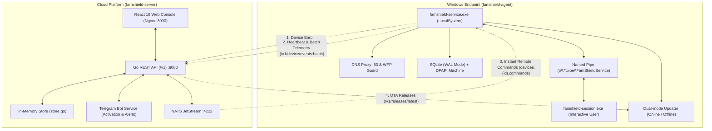
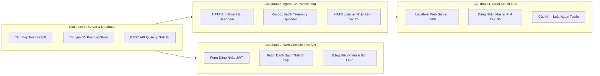

# FamShield Ecosystem Gap Analysis and Implementation Roadmap

Tài liệu này ghi nhận kết quả rà soát, kiểm kê và đánh giá toàn diện hiện trạng kỹ thuật giữa hai repository:
1. **Windows Agent (Rust):** [`child_monitor`](https://github.com/nntu/famshield-agent)
2. **Cloud Server & Web Console (Go/React):** [`famshield-server`](https://github.com/nntu/famshield-server)

Đồng thời xác định các khoảng trống kỹ thuật (Gaps) còn thiếu và thiết lập lộ trình thực thi hoàn thiện sản phẩm.

---

## 1. Hiện Trạng Kiến Trúc Tổng Thể

Hệ sinh thái FamShield được phân tách thành 2 dự án độc lập:



---

## 2. Ma Trận Đánh Giá Tính Năng (Feature Matrix & Gap Assessment)

| Thành Phần | Hạng Mục Kỹ Thuật | Trạng Thái Hiện Tại | Đánh Giá Kỹ Thuật & Khoảng Trống (Gap) | Mức Độ Ưu Tiên |
| :--- | :--- | :---: | :--- | :---: |
| **Server** | **Lưu trữ dữ liệu (Database)** | ⚠️ **Tạm thời** | Sử dụng `MemoryStore` trong RAM. Restart container sẽ mất dữ liệu thiết bị, tài khoản và logs. Cần chuyển sang **PostgreSQL**. | **P0** (Bắt buộc) |
| **Server** | **Xác thực mTLS & CA** | ⚠️ **Mock chuỗi** | Endpoint `/v1/device/enroll` trả về chuỗi PEM tĩnh. Cần cấp chứng chỉ x509 thật từ CA nội bộ. | **P1** |
| **Server** | **Quản lý & Ký số Policy** | ❌ **Chưa có** | Chưa có API tạo draft policy, validate schema `policy.schema.json`, publish version, và ký số payload bằng ECDSA P-256. | **P1** |
| **Server** | **Lưu trữ ảnh bằng chứng (Evidence)** | ❌ **Chưa có** | Chưa có handler `POST /v1/device/evidence/{evidence_id}` nhận JPEG binary, lưu Object Storage (MinIO/S3) và TTL 48h. | **P2** |
| **Server** | **Telegram Bot kích hoạt & cảnh báo** | ✅ **Hoàn thành** | Đã triển khai kích hoạt 1-chạm qua deep-link (`/start <token>`), OTP 6 số, và đẩy tin nhắn cảnh báo tức thì. | Hoàn tất |
| **Server** | **NATS JetStream Queue** | ✅ **Hoàn thành** | Đã cấu hình NATS JetStream container, publish sự kiện telemetry và lệnh điều khiển từ xa. | Hoàn tất |
| **Web UI** | **Đăng ký & Tải bộ cài** | ✅ **Hoàn thành** | Modal đăng ký kích hoạt Telegram và download file `FamShieldSetup.exe` trực tiếp. | Hoàn tất |
| **Web UI** | **Đa ngôn ngữ (i18n)** | ✅ **Hoàn thành** | Hỗ trợ song ngữ Tiếng Việt (mặc định) và Tiếng Anh. | Hoàn tất |
| **Web UI** | **Kết nối API thật** | ⚠️ **Dữ liệu Mock** | Các danh sách thiết bị, trẻ em và sự kiện trong `App.tsx` đang dùng `useState` tĩnh, chưa gọi API từ Server. | **P0** |
| **Web UI** | **Quản lý Luật (Rule Management)** | ❌ **Chưa có** | Chưa có giao diện thêm/sửa/xóa quy tắc chặn app, chặn web, lịch sử dụng cho từng trẻ em. | **P1** |
| **Web UI** | **Xem ảnh bằng chứng vi phạm** | ❌ **Chưa có** | Chưa có gallery xem ảnh chụp màn hình vi phạm đã làm mờ và nút duyệt gia hạn giờ chơi. | **P2** |
| **Agent** | **Dịch vụ Windows Service (SCM)** | ✅ **Hoàn thành** | Service Control Manager Dispatcher chuẩn, Interactive Console mode, Named Pipe SDDL. | Hoàn tất |
| **Agent** | **DNS Proxy & WFP Firewall** | ✅ **Hoàn thành** | Bind loopback `127.0.0.2:53`, Dynamic WFP session chống rò rỉ và BSOD, chặn port 53 ngoại vi. | Hoàn tất |
| **Agent** | **Giám sát Kernel ETW** | ✅ **Hoàn thành** | Bắt sự kiện tạo/hủy tiến trình 0ms qua ETW, ToolHelp32 fallback, phát hiện vi phạm. | Hoàn tất |
| **Agent** | **Bảo mật Master PIN & DPAPI** | ✅ **Hoàn thành** | Argon2id + salt ngẫu nhiên, mã hóa DPAPI machine-scope, lockout chống brute-force. | Hoàn tất |
| **Agent** | **Chụp màn hình mờ bảo vệ riêng tư** | ✅ **Hoàn thành** | GDI BitBlt, Gaussian Blur trong RAM, nén JPEG < 150 KiB, tự hủy sau 48h. | Hoàn tất |
| **Agent** | **Dual-mode Auto-Updater** | ✅ **Hoàn thành** | Cập nhật Online (xác thực ECDSA manifest) & Ngoại tuyến (USB hot-folder), rollback an toàn. | Hoàn tất |
| **Agent** | **Bộ cài đặt Inno Setup 64-bit** | ✅ **Hoàn thành** | Native 64-bit (`C:\Program Files\FamShield`), ký số Authenticode SHA-256. | Hoàn tất |
| **Agent** | **HTTP & NATS Client kết nối mạng** | ✅ **Hoàn thành** | `CloudSyncClient` tối ưu Connection Pool HTTP + TCP keepalive, Telemetry v1.1 adaptive batching, và `NatsConnectionWorker` kết nối NATS WebSocket (`wss://`) trên cổng 443 (Cloudflare Tunnel tương thích), nhận lệnh từ xa tức thì sub-second. | Hoàn tất |
| **Agent** | **Giao diện Local Admin Web UI** | ✅ **Hoàn thành** | Giao diện Web Admin cục bộ độc lập (Vite React trên `127.0.0.1:38123`), bảo mật 2FA TOTP (Google/Microsoft Authenticator & backup codes), quản lý Rules, Telemetry Reports, 5 cấp độ Blur, an toàn cho chế độ 100% Offline Free. | Hoàn tất |
| **Agent** | **Quản lý Migration & Snapshot DB** | ✅ **Hoàn thành** | Tích hợp Refinery 0.10 với migration V1-V6 nhúng nhị phân, tự động sao lưu an toàn bằng SQLite Online Backup API (`famshield.migration_backup.db`) chống hỏng hóc DB khi nâng cấp. | Hoàn tất |

---

## 3. Chi Tiết 4 Khoảng Trống Kỹ Thuật Cốt Lõi (Core Gaps)

### 3.1. Khoảng trống 1: Cơ sở dữ liệu Persistent cho Cloud Server (P0)
- **Hiện trạng:** `famshield-server/server/pkg/store/store.go` đang dùng `MemoryStore`.
- **Rủi ro:** Khi container khởi động lại hoặc gặp sự cố, toàn bộ dữ liệu tài khoản phụ huynh đã kích hoạt qua Telegram, thiết bị đã ghép nối và lịch sử vi phạm đều bị mất sạch.
- **Yêu cầu giải quyết:**
  - Thêm container `postgres:16-alpine` vào `docker-compose.yml`.
  - Triển khai `PostgresStore` thay thế `MemoryStore` với các bảng: `users`, `tenants`, `devices`, `policies`, `device_events`, `visual_evidences`, `commands`.
  - Giữ `MemoryStore` làm cache phục vụ xử lý luồng sự kiện NATS tốc độ cao.

### 3.2. Khoảng trống 2: Kết Nối API Thật Giữa Web Console và Server (P0)
- **Hiện trạng:** `web/src/App.tsx` sử dụng mock state:
  ```typescript
  const [devices] = useState<Device[]>([ ... ]); // Mock tĩnh
  ```
- **Rủi ro:** Người dùng đăng ký thành công qua Telegram nhưng khi truy cập Web Console không thể xem thiết bị thật hay điều khiển máy tính.
- **Yêu cầu giải quyết:**
  - Xây dựng API Client (`axios` / `fetch`) kết nối về backend `/v1/`.
  - Màn hình Đăng nhập (Login Form) bằng Email & Password, lưu phiên đăng nhập an toàn.
  - Tải danh sách thiết bị động từ `/v1/admin/devices` và sinh mã ghép nối 6 chữ số từ `/v1/admin/enrollment-codes`.
  - Giao diện gửi lệnh tức thì: Khóa máy ngay (`lock_session`), cập nhật danh sách đen (`update_blacklist`), reset PIN.

### 3.3. Khoảng trống 3: Tích Hợp Kết Nối Mạng Thực Tế Giữa Agent và Server (P1)
- **Trạng thái:** ✅ **Đã hoàn thành (Delivered)**
- **Hiện thực:**
  - Crate `famshield-sync` tích hợp `reqwest` Connection Pool tối ưu TCP keepalive, TCP nodelay, idle timeouts.
  - Hỗ trợ Telemetry Protocol v1.1 với `AppUsagePayload` ghi nhận thời gian sử dụng foreground active time, `dns_query` thống kê latency và upstream resolver.
  - Bộ điều phối nhịp tim (Heartbeat) định kỳ báo cáo tình trạng Dynamic Learning DNS Balancer (`dns_upstream_optimal`, `dns_avg_rtt_ms`).
  - Hàng đợi Outbox SQLite sử dụng cơ chế Adaptive Batching tự động tăng kích thước batch từ 50 lên 100 khi phát hiện tồn đọng > 100 sự kiện.
  - `NatsConnectionWorker` kết nối qua NATS WebSocket (`wss://`) trên cổng 443 đi qua Cloudflare Tunnel, lắng nghe kênh `devices.{device_id}.commands` và gửi ACK về `devices.{device_id}.command_results`, hoàn toàn Outbound không cần mở cổng NAT router.

### 3.4. Khoảng trống 4: Giao Diện Quản Trị Cục Bộ Cho Bản Miễn Phí (Local Admin UI - Milestone 5) (P2)
- **Trạng thái:** ✅ **Đã hoàn thành (Delivered)**
- **Hiện thực:**
  - Triển khai crate `famshield-local-admin` độc lập chạy Web Server trên `http://127.0.0.1:38123` (với các cổng dự phòng tự động).
  - Giao diện Single Page App (SPA) responsive xây dựng bằng Vite React và Tailwind CSS, tích hợp sẵn trong bundle nhị phân.
  - Xác thực Master PIN bảo vệ qua Argon2id và Windows DPAPI machine-scope; hỗ trợ bảo mật 2 lớp 2FA TOTP (Google/Microsoft Authenticator và 8 mã khẩn cấp).
  - Quản lý quy tắc ứng dụng/tên miền trực tiếp xuống SQLite cục bộ, biểu đồ phân tích thời gian dùng máy, cấu hình 5 cấp độ làm mờ ảnh chụp màn hình, và chức năng xóa an toàn nhật ký báo cáo.

---

## 4. Lộ Trình Triển Khai Hoàn Thiện (Implementation Roadmap)



### Kế hoạch hành động theo thứ tự ưu tiên:

1. **Bước 1 (PostgreSQL & Persistent Server Storage):**
   - Viết cấu hình `postgres` trong `famshield-server/docker-compose.yml`.
   - Triển khai `PostgresStore` đảm bảo toàn bộ dữ liệu người dùng, thiết bị, và sự kiện vi phạm được lưu trữ bền vững.
2. **Bước 2 (Web Console Live Data & Control Panel):**
   - Bổ sung trang Đăng nhập (Login) trên Web Console.
   - Kết nối `App.tsx` vào API `/v1/admin/devices` để hiển thị đúng các máy trạm đang online/offline.
   - Thêm nút kích hoạt lệnh tức thì: "Khóa máy ngay" và "Đổi PIN máy trạm".
3. **Bước 3 (Agent Live Sync & Telemetry):**
   - Cập nhật `agent/crates/sync` với `reqwest` thực hiện ghép nối mã 6 chữ số và gửi nhịp tim định kỳ.
   - Kết nối NATS JetStream thực tế để nhận lệnh khóa máy từ xa $< 1\text{s}$.
4. **Bước 4 (Local Admin Web UI cho Bản Miễn Phí):**
   - Xây dựng giao diện web cục bộ phục vụ người dùng ngoại tuyến không có nhu cầu kết nối đám mây.
