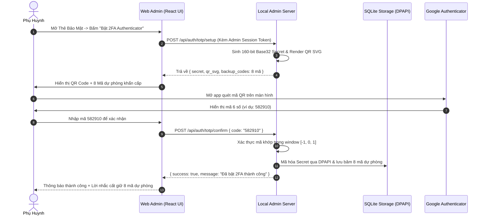

# Kế Hoạch Thiết Kế: Xác Thực 2 Lớp (2FA / TOTP) Cho Phụ Huynh Qua Ứng Dụng Authenticator

> **Tài liệu**: `docs/15-PARENT-2FA-TOTP-PLAN.md`  
> **Trạng thái**: Đã phê duyệt (Approved Design)  
> **Phân hệ**: `famshield-local-admin`, `web`, `famshield-storage`  
> **Chuẩn kỹ thuật**: RFC 6238 (TOTP), RFC 4226 (HOTP), Windows DPAPI  

---

## 1. Tầm Nhìn & Mục Tiêu Kỹ Thuật

Nhằm bảo vệ tuyệt đối bảng điều khiển quản trị phụ huynh (`Local Web Admin`) trước nguy cơ trẻ em nhìn lén Master PIN (Shoulder Surfing) hoặc đoán mật khẩu, FamShield Agent tích hợp chuẩn **Xác thực 2 Lớp TOTP (Time-based One-Time Password)** thông qua các ứng dụng di động phổ biến:
- Google Authenticator
- Microsoft Authenticator
- Apple Keychain
- Authy / 1Password / Bitwarden

### Nguyên Tắc Bắt Buộc:
1. **100% Hoạt Động Ngoại Tuyến (Offline-First)**: Không phụ thuộc vào Internet, SMS gateway, hay Email server của bên thứ ba. Hoàn toàn tương thích và bảo toàn nguyên lý bảo vệ riêng tư của chế độ `OperatingMode::StandaloneFree`.
2. **Bảo Vệ Khóa Bí Mật Bằng Windows DPAPI**: Mã hóa khóa bí mật (Secret Key) cấp máy trạm (`CryptProtectData`) trước khi ghi xuống SQLite. Tuyệt đối cấm lưu trữ dạng plain-text.
3. **Mã Khẩn Cấp Dùng 1 Lần (Single-Use Emergency Backup Codes)**: Cung cấp 8 mã dự phòng khẩn cấp phòng trường hợp phụ huynh mất, hỏng hoặc đổi điện thoại.

---

## 2. Kiến Trúc Mật Mã & Thuật Toán TOTP (RFC 6238)

### 2.1. Cấu Trúc Khóa Bí Mật & URI Format
- Khóa bí mật chung ($K$): Chuỗi nhị phân 160-bit (20 bytes) được sinh ngẫu nhiên an toàn bằng CSPRNG (`rand::rngs::OsRng`), mã hóa dưới dạng Base32 (32 ký tự, không phân biệt hoa thường).
- Định dạng URI chuẩn RFC 6238:
  ```text
  otpauth://totp/FamShield:{ComputerName}?secret={BASE32_SECRET}&issuer=FamShield&algorithm=SHA1&digits=6&period=30
  ```
- **Sinh Mã QR Trực Tiếp Trong RAM**: Backend sử dụng crate `qrcode = "0.14"` render mã QR thành vector đồ họa **SVG** hoặc chuỗi Base64 Data URL gửi trực tiếp lên Web Admin. Phụ huynh quét bằng camera điện thoại trong vòng 1 giây mà không phát sinh bất kỳ kết nối mạng ra ngoài.

### 2.2. Tính Toán & Kiểm Tra Mã Xác Thực
- Chu kỳ thời gian ($T_0 = 0$, $X = 30\text{s}$):
  $$T = \left\lfloor \frac{\text{CurrentUnixTime}()}{30} \right\rfloor$$
- Băm HMAC:
  $$\text{HMAC} = \text{HMAC-SHA1}(K, T)$$
- Lấy 6 chữ số qua Dynamic Truncation chuẩn RFC 4226:
  $$\text{Code} = (\text{Truncate}(\text{HMAC}) \bmod 10^6)$$
- **Cửa Sổ Dung Sai Lệch Thời Gian (Clock Drift Tolerance)**:
  Để hỗ trợ sai số đồng hồ giữa máy tính Windows và điện thoại, hệ thống chấp nhận mã trong khoảng:
  $$W \in [-1, 0, +1] \times 30\text{s}$$

---

## 3. Luồng Hoạt Động (Workflows)

### 3.1. Luồng Kích Hoạt 2FA (Onboarding & Activation)


### 3.2. Luồng Đăng Nhập 2 Bước Hàng Ngày (Two-Step Login)
1. **Bước 1 (Master PIN)**:
   - Phụ huynh nhập Master PIN tại `PinModal.tsx`.
   - Web Server xác thực PIN qua Argon2id. Nếu đúng và hệ thống **chưa bật 2FA**, cấp Session Token và mở Dashboard ngay.
   - Nếu hệ thống **đã bật 2FA**, trả về phản hồi:
     ```json
     {
       "requires_totp": true,
       "temp_auth_token": "tmp-auth-uuid-v4",
       "message": "Vui lòng nhập mã OTP 6 số từ Google Authenticator"
     }
     ```
2. **Bước 2 (Xác thực OTP 6 số hoặc Mã Dự Phòng)**:
   - Giao diện `PinModal.tsx` tự động chuyển sang 6 ô nhập mã OTP bảo mật.
   - Phụ huynh mở ứng dụng Authenticator, nhập mã 6 số.
   - Web Admin gọi API `POST /api/auth/login/totp`:
     ```json
     {
       "temp_auth_token": "tmp-auth-uuid-v4",
       "code": "582910"
     }
     ```
   - Nếu nhập Mã Dự Phòng (8 ký tự ví dụ `A7B2-9K1F`): Hệ thống kiểm tra với danh sách hash trong DB. Nếu khớp, hủy mã dự phòng đó (burn-after-use) và cho phép đăng nhập.
   - Cấp Session Token chính thức, mở Dashboard.

### 3.3. Khóa Bảo Vệ Thao Tác Trọng Yếu (Step-Up Authentication)
Bắt buộc phải nhập lại OTP 6 số khi thực hiện các hành động nguy hiểm:
- Gỡ cài đặt FamShield (`POST /api/system/uninstall`).
- Đổi Master PIN mới (`POST /api/auth/change-pin`).
- Tắt tính năng bảo vệ mạng hoặc khôi phục cấu hình gốc.

---

## 4. Thiết Kế Schema Dữ Liệu SQLite

Bổ sung bảng lưu trữ cấu hình 2FA trong `agent/crates/storage/src/schema.rs`:

```sql
CREATE TABLE IF NOT EXISTS parent_2fa_config (
    id INTEGER PRIMARY KEY CHECK (id = 1),
    enabled INTEGER NOT NULL DEFAULT 0,
    encrypted_secret BLOB,          -- DPAPI-encrypted Base32 Secret Key
    created_at TEXT NOT NULL,
    last_verified_at TEXT
);

CREATE TABLE IF NOT EXISTS parent_backup_codes (
    code_hash TEXT PRIMARY KEY,     -- SHA-256 hash của mã dự phòng
    used INTEGER NOT NULL DEFAULT 0,
    used_at TEXT
);
```

---

## 5. Danh Sách REST API Chi Tiết

| Endpoint | Method | Quyền Hạn | Mô Tả Chức Năng |
| :--- | :--- | :--- | :--- |
| `/api/auth/totp/status` | `GET` | Authenticated | Kiểm tra trạng thái 2FA (đã bật hay chưa). |
| `/api/auth/totp/setup` | `POST` | Authenticated | Khởi tạo Secret Key, SVG QR Code và danh sách 8 mã dự phòng mới. |
| `/api/auth/totp/confirm` | `POST` | Authenticated | Xác nhận mã OTP đầu tiên để chính thức kích hoạt 2FA. |
| `/api/auth/totp/disable` | `POST` | Authenticated | Tắt 2FA (Bắt buộc xác thực cả Master PIN lẫn mã OTP hiện tại). |
| `/api/auth/login/totp` | `POST` | Public (TempToken) | Bước 2 của quy trình đăng nhập bằng mã 6 số hoặc mã dự phòng. |

---

## 6. Kế Hoạch Triển Khai (Milestones)

1. **Milestone 1**: Thêm crate `totp-rs = "6.0"` (Builder pattern, stack-allocated Token) vào `Cargo.toml`.
2. **Milestone 2**: Xây dựng module `famshield_local_admin::totp` và các schema SQLite trong `famshield-storage`.
3. **Milestone 3**: Tích hợp các REST API trong `LocalAdminServer`.
4. **Milestone 4**: Cập nhật giao diện `PinModal.tsx` và `SecurityTab.tsx` trong `web`.
5. **Milestone 5**: Kiểm thử đơn vị (Unit tests) và kiểm thử đối kháng (brute-force lockout test).
