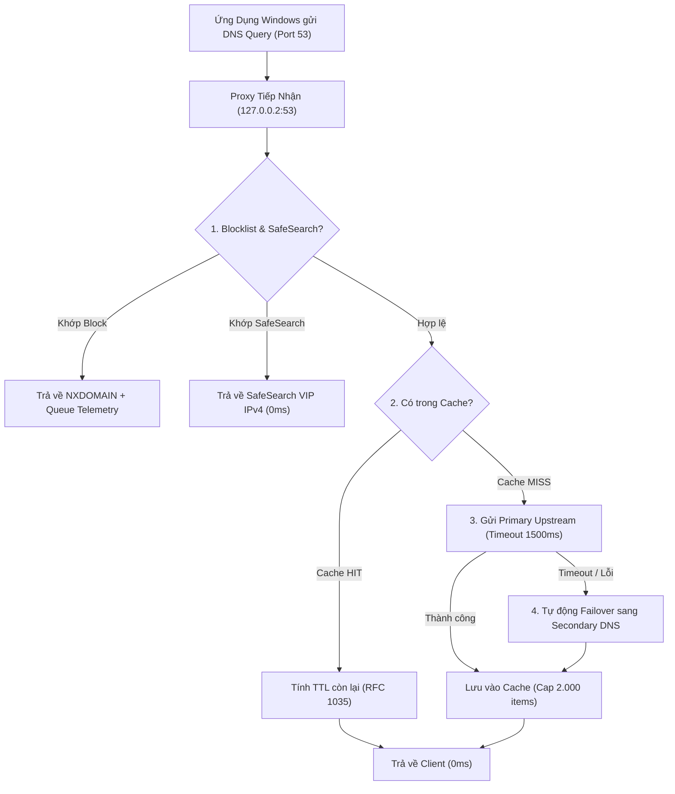

# Kế Hoạch Thiết Kế: Bộ Nhớ Đệm DNS Tinh Gọn & Tự Nhận Diện DNS Hệ Thống (Lean DNS Cache & Auto-Detect System DNS)

> **Tài liệu**: `docs/16-NUMA-DNS-CACHE-AND-MULTI-UPSTREAM-PLAN.md`  
> **Trạng thái**: Đã phê duyệt & Đang triển khai (Approved & Active Implementation)  
> **Triết lý kỹ thuật**: Gọn gàng, ít lỗi, chạy mượt mà trên mọi máy tính gia đình (KISS - Keep It Simple, Robust)  
> **Phân hệ**: `famshield-windows`, `famshield-dns`, `famshield-local-admin`, `web`  

---

## 1. Triết Lý & Mục Tiêu Thiết Kế Tinh Gọn

Phân hệ DNS hoạt động như một tiện ích bổ trợ thiết yếu, không làm phức tạp hóa kiến trúc:
1. **Tự Động Nhận Diện DNS Hiện Tại Của Máy (Auto-Detect System DNS)**:
   - Khi FamShield khởi động hoặc người dùng vào giao diện quản trị, hệ thống tự động quét các card mạng đang hoạt động để tìm DNS gốc của máy (thường là IP Router gia đình như `192.168.1.1` hoặc DNS của VNPT, Viettel, FPT).
   - Tự động đưa DNS này thành lựa chọn hàng đầu trên Web Admin, đảm bảo không bao giờ làm hỏng việc truy cập các trang nội bộ (Router Admin, NAS, máy in, mạng trường học).
2. **Bộ Nhớ Đệm Siêu Nhẹ ($\le 2\text{ MB RAM}$, Cap 2.000 Bản Ghi)**:
   - Đủ lớn để lưu trữ toàn bộ các tên miền học tập, giải trí hàng ngày.
   - Trừ lùi TTL động chuẩn RFC 1035 trước khi trả về client.
   - **Tự động xóa sạch Cache (Auto-Flush)** ngay khi phụ huynh thêm/sửa/xóa tên miền trong Danh Sách Đen hoặc thay đổi SafeSearch, đảm bảo luật mới có hiệu lực tức thì.
3. **Cơ Chế Dự Phòng (Failover 2 Lớp) Thay Vì Parallel Race Cồng Kềnh**:
   - Truy vấn máy chủ DNS chính (Primary); nếu quá $1500\text{ms}$ không thấy phản hồi hoặc rớt gói, tự động chuyển sang máy chủ dự phòng (Secondary).
   - Tránh việc bắn đồng thời x4 gói tin UDP gây nghẽn router Wi-Fi gia đình.

---

## 2. Danh Sách Lựa Chọn Upstream Trên Web Admin

Giao diện Web Admin cung cấp menu chọn nhanh:
1. `🖥️ DNS Hiện Tại Của Máy ({detected_ip})`: Ví dụ `192.168.1.1` hoặc DNS gốc do nhà mạng cấp.
2. `☁️ Cloudflare (1.1.1.1)`: Nhanh, bảo mật, riêng tư cao.
3. `🔍 Google Public DNS (8.8.8.8)`: Ổn định toàn cầu.
4. `🛡️ Quad9 (9.9.9.9)`: Tích hợp sẵn chặn mã độc.
5. `✏️ Tùy Chỉnh (Custom IP)`: Cho phép tự nhập IP mong muốn.

---

## 3. Kiến Trúc Luồng Xử Lý

---

## 4. Các Bước Triển Khai Vào Codebase

1. **`famshield-windows`**:
   - Thêm hàm `get_system_dns_servers() -> Vec<String>` đọc DNS từ adapter mạng hoặc registry Windows (lọc bỏ `127.0.0.1` và `127.0.0.2`).
2. **`famshield-dns`**:
   - Cập nhật `DnsCache`: Thêm giới hạn dung lượng $2.000$ mục, hàm `flush()` dọn sạch cache, và tính toán TTL còn lại.
   - Cập nhật `DnsProxy`: Hỗ trợ danh sách upstream `Vec<SocketAddr>` với cơ chế tự động Failover sang server phụ khi server chính timeout.
3. **`famshield-local-admin`**:
   - Thêm API:
     - `GET /api/dns/config`: Trả về DNS hiện tại của máy, DNS đang chọn, và thống kê cache.
     - `POST /api/dns/config`: Cập nhật DNS upstream mong muốn.
     - `POST /api/dns/cache/flush`: Xóa sạch cache theo yêu cầu.
   - Tự động gọi `flush_cache()` khi thêm/sửa/xóa quy tắc chặn hoặc đổi SafeSearch.
4. **`web` (React UI)**:
   - Thêm khối "Cấu Hình DNS Máy Trạm" trong thẻ *Bảo Mật* với danh sách tùy chọn trực quan.
