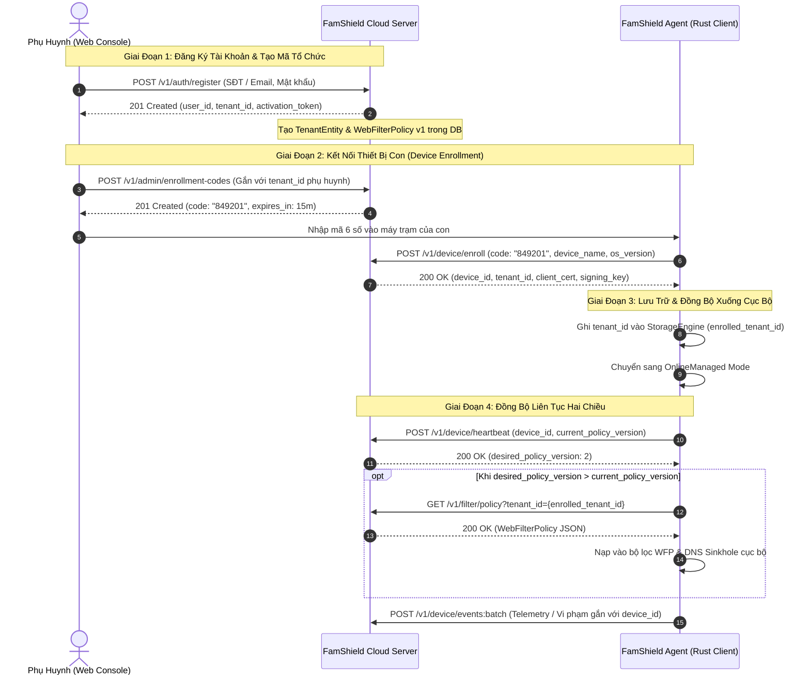
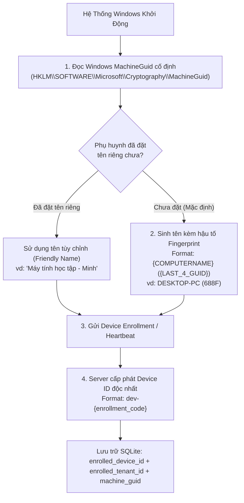

# Hướng Dẫn Tích Hợp & Đồng Bộ Mã Tổ Chức (Tenant ID) Cho Client Agent

Tài liệu này mô tả chi tiết quy trình quản lý, cấp phát và đồng bộ **Mã Tổ Chức (Tenant ID)** giữa **FamShield Cloud Server (Go Backend)**, **Web Console** và **FamShield Client Agent (Rust Windows Service)**.

---

## 1. Tổng Quan Kiến Trúc & Ranh Giới Cô Lập Multi-Tenant

Trong FamShield, **Mã Tổ Chức (`tenant_id`)** là định danh cấp cao nhất xác định phạm vi bảo vệ của một gia đình hoặc một tổ chức:

- Mỗi tài khoản Phụ huynh / Quản trị viên (`User`) khi đăng ký sẽ sở hữu một `Tenant ID` độc nhất (định dạng `tenant-usr-<hex>`).
- Toàn bộ dữ liệu cấu hình, quy tắc an toàn, danh sách thiết bị và nhật ký duyệt web được cô lập hoàn toàn dựa trên `Tenant ID`:
  - **Chính sách lọc Web (`WebFilterPolicy`):** Danh mục cấm, danh sách trắng/đen, cấu hình SafeSearch, giờ giới hạn.
  - **Thiết bị (`Device`):** Các máy trạm Windows của con được gắn trực tiếp vào `Tenant ID`.
  - **Sự kiện vi phạm (`IngestedEvent` / `VisualEvidenceMetadata`):** Đẩy từ thiết bị lên chỉ hiển thị cho phụ huynh cùng `Tenant ID`.



---

## 2. Chi Tiết Các API Giao Tiếp Phía Client

### 2.1. Đăng Ký Tài Khoản & Sinh Mã Tổ Chức (`POST /v1/auth/register`)

Phụ huynh khởi tạo tài khoản quản lý trên Web Console hoặc Telegram:

- **Endpoint:** `POST /v1/auth/register`
- **Request:**
  ```json
  {
    "email": "parent@example.com",
    "phone_number": "0912345678",
    "password": "SecurePassword123!",
    "telegram_username": "my_telegram"
  }
  ```
- **Response (`201 Created`):**
  ```json
  {
    "user_id": "usr-8f7b3e1a",
    "email": "parent@example.com",
    "phone_number": "+84912345678",
    "status": "pending_activation",
    "tenant_id": "tenant-usr-8f7b3e1a",
    "telegram_bot_url": "https://t.me/FamShieldBot?start=act_8f7b3e1a90c21345",
    "activation_token": "act_8f7b3e1a90c21345",
    "activation_code": "582910",
    "totp_secret": "JBSWY3DPEHPK3PXP",
    "otpauth_url": "otpauth://totp/FamShield:usr-8f7b3e1a?secret=JBSWY3DPEHPK3PXP&issuer=FamShield",
    "expires_at": "2026-10-25T18:40:00Z"
  }
  ```

---

### 2.2. Ghép Nối Thiết Bị & Nhận Tenant ID (`POST /v1/device/enroll`)

Khi người dùng cài đặt FamShield Agent lên máy tính cần bảo vệ và nhập mã kết nối 6 chữ số:

- **Endpoint:** `POST /v1/device/enroll` (hoặc `/devices/enroll`)
- **Headers:** `Content-Type: application/json`
- **Request Body:**
  ```json
  {
    "enrollment_code": "849201",
    "device_name": "DESKTOP-CON",
    "os_version": "Microsoft Windows 11 Pro 64-bit"
  }
  ```
- **Response Body (`200 OK`):**
  ```json
  {
    "device_id": "dev-a1b2c3d4",
    "tenant_id": "tenant-usr-8f7b3e1a",
    "client_certificate_pem": "-----BEGIN CERTIFICATE-----\n...\n-----END CERTIFICATE-----",
    "ca_certificate_pem": "-----BEGIN CERTIFICATE-----\n...\n-----END CERTIFICATE-----",
    "command_signing_key": "sec_89df7a23c4e1..."
  }
  ```

> [!IMPORTANT]
> **Quy định xử lý tại Client Agent:**
> - Trường `tenant_id` trong phản hồi phản ánh chính xác Tổ chức / Gia đình mà thiết bị này thuộc về.
> - Client phải lưu `tenant_id` vào storage bảo mật cục bộ trước khi kích hoạt `device_id`.

---

### 2.3. Kiểm Tra Trạng Thái & Phiên Bản Chính Sách (`POST /v1/device/heartbeat`)

Định kỳ mỗi 30-60 giây, Agent gửi heartbeat lên Server:

- **Endpoint:** `POST /v1/device/heartbeat`
- **Request Body:**
  ```json
  {
    "device_id": "dev-a1b2c3d4",
    "agent_version": "1.0.4",
    "policy_version": 1,
    "health_status": "healthy",
    "uptime_seconds": 3600,
    "wfp_active": true,
    "dns_active": true,
    "outbox_depth": 0
  }
  ```
- **Response Body (`200 OK`):**
  ```json
  {
    "status": "online",
    "nats_connected": true,
    "server_time": "2026-10-24T18:45:00Z",
    "desired_policy_version": 2,
    "command_wait_seconds": 25
  }
  ```

---

### 2.4. Kéo Chính Sách Bảo Vệ Của Tổ Chức (`GET /v1/filter/policy`)

Khi `desired_policy_version > policy_version`, Agent dùng `tenant_id` đã lưu để tải bộ chính sách mới:

- **Endpoint:** `GET /v1/filter/policy?tenant_id={enrolled_tenant_id}`
- **Response Body (`200 OK`):**
  ```json
  {
    "tenant_id": "tenant-usr-8f7b3e1a",
    "version": 2,
    "block_adult": true,
    "block_gambling": true,
    "block_violence": true,
    "block_social": false,
    "block_gaming": true,
    "safesearch_enabled": true,
    "youtube_restricted": true,
    "silent_mode": true,
    "monitor_only_mode": false,
    "dns_block_action": "nxdomain",
    "custom_blocked_domains": ["discord.com", "steamcommunity.com"],
    "custom_allowed_domains": ["khanacademy.org", "wikipedia.org"],
    "schedule_rules": [
      {
        "day_of_week": 1,
        "start_hour": 8,
        "end_hour": 17,
        "category": "gaming"
      }
    ],
    "updated_at": "2026-10-24T18:42:00Z"
  }
  ```

---

## 3. Kiến Trúc Cài Đặt Tại Client (Rust Agent Implementation)

### 3.1. Các Hằng Số Khóa Siêu Dữ Liệu (Metadata Keys)

Trong file `crates/sync/src/enrollment.rs`:

```rust
pub const META_ENROLLED_DEVICE_ID: &str = "enrolled_device_id";
pub const META_ENROLLED_TENANT_ID: &str = "enrolled_tenant_id";
pub const META_ENROLLED_CERT_PEM: &str = "enrolled_client_cert_pem";
pub const META_COMMAND_SIGNING_KEY: &str = "enrolled_command_signing_key";
```

### 3.2. Lưu Trữ Khi Ghép Nối Thành Công (Atomic Persistence)

Để tránh lỗi trạng thái khi ghi đè dở dang, quá trình lưu trữ tuân thủ thứ tự:

```rust
// 1. Xóa tạm thời device_id (commit marker)
self.storage.set_meta(META_ENROLLED_DEVICE_ID, "")?;

// 2. Lưu trữ Tenant ID và chứng chỉ
self.storage.set_meta(META_ENROLLED_TENANT_ID, &resp.tenant_id)?;
self.storage.set_meta(META_ENROLLED_CERT_PEM, &resp.client_certificate_pem)?;
self.storage.set_meta(META_COMMAND_SIGNING_KEY, &protected_signing_key)?;

// 3. Ghi nhận device_id cuối cùng để kích hoạt OnlineManaged Mode
self.storage.set_meta(META_ENROLLED_DEVICE_ID, &resp.device_id)?;
```

### 3.3. Kiểm Tra Chế Độ Hoạt Động (Operating Mode)

```rust
pub fn is_enrolled(&self) -> bool {
    let has_device = self.storage.get_meta(META_ENROLLED_DEVICE_ID).ok().flatten().is_some();
    let has_tenant = self.storage.get_meta(META_ENROLLED_TENANT_ID).ok().flatten().is_some();
    has_device && has_tenant
}
```

- Nếu `is_enrolled() == false`: Chế độ **`StandaloneFree`** (Bảo vệ offline cục bộ, không gửi dữ liệu ra ngoài).
- Nếu `is_enrolled() == true`: Chế độ **`OnlineManaged`** (Nhận lệnh từ xa, đồng bộ chính sách theo `tenant_id`).

---

## 4. Bảng Tra Cứu Mã Lỗi Khi Ghép Nối

| Mã Lỗi HTTP | Error Code | Ý Nghĩa & Cách Xử Lý |
| :--- | :--- | :--- |
| `400 Bad Request` | `invalid_request` | Dữ liệu gửi lên sai định dạng hoặc thiếu `enrollment_code`. |
| `401 Unauthorized` | `invalid_enrollment_code` | Mã OTP 6 số không đúng, đã hết hạn (quá 15 phút), hoặc đã được sử dụng trước đó. Cần sinh mã mới từ Web Console. |
| `409 Conflict` | `device_already_enrolled` | Thiết bị đã được ghép nối trong một tổ chức khác mà chưa được hủy liên kết. |
| `500 Server Error`| `internal_error` | Lỗi cơ sở dữ liệu server. Client giữ nguyên trạng thái cục bộ và thử lại sau. |

---

## 5. Phương Án Nhận Diện Duy Nhất & Chống Trùng Lặp Tên Máy Tính (Device Disambiguation & Machine Identity)

### 5.1. Thách Thức Về Trùng Lặp Tên Máy Tính Trong Thực Tế

Trong môi trường hộ gia đình có nhiều con cái, hoặc trường học / doanh nghiệp triển khai hàng loạt:
- Hệ điều hành Windows thường tự động đặt tên mặc định trùng nhau hoặc na ná nhau: `DESKTOP-FAMSHIELD`, `DESKTOP-XXXXXXX`, `LAPTOP-USER`.
- Các bản ghost / image cài đặt hàng loạt thường giữ nguyên hostname ban đầu.
- **Hệ quả nếu không phân biệt:** Phụ huynh nhìn vào Web Console hoặc Telegram Bot sẽ thấy 2 hoặc nhiều máy cùng mang tên `DESKTOP-FAMSHIELD`, không thể phân biệt máy nào là của con lớn, máy nào là của con nhỏ để gán chính sách hay xem lịch sử vi phạm.

### 5.2. Giải Pháp Định Danh Đa Lớp (Multi-Layer Identity)

FamShield Agent áp dụng chiến lược định danh 4 lớp chặt chẽ:



1. **Dấu vân tay phần cứng / hệ điều hành (`MachineGuid`)**:
   - Được đọc từ registry Windows: `HKLM\SOFTWARE\Microsoft\Cryptography\MachineGuid`.
   - Đây là chuỗi UUID 128-bit cố định được Windows sinh ra khi cài đặt hệ điều hành, bất biến qua các lần khởi động lại hay thay đổi mạng.
   - Module [`famshield_windows::identity`](file:///d:/projects/famshield/famshield-agent/agent/crates/windows/src/identity.rs) trích xuất an toàn và lưu vào `agent_meta.machine_guid`.

2. **Cơ chế chống trùng tên tự động (`get_disambiguated_device_name`)**:
   - Khi thiết bị chưa được phụ huynh đặt tên thân thiện riêng, Agent tự động lấy 4 ký tự hex cuối cùng của `MachineGuid` làm hậu tố phân biệt:
     $$\text{DeviceName} = \text{COMPUTERNAME} + \text{" ("} + \text{GUID}[-4:] + \text{")"}$$
   - *Ví dụ thực tế:*
     - Máy con trai: `DESKTOP-FAMSHIELD (688F)`
     - Máy con gái: `DESKTOP-FAMSHIELD (9B12)`
   - Ngay cả khi 2 máy có cùng hostname Windows, tên hiển thị trên bảng điều khiển phụ huynh vẫn khác biệt 100%.

3. **Tên thiết bị thân thiện do phụ huynh chỉ định (Friendly Custom Name)**:
   - Phụ huynh có thể chủ động đổi tên bất kỳ lúc nào trực tiếp trên Local Admin Web (`SecurityTab.tsx`) hoặc qua API `POST /api/settings/server`:
     ```json
     {
       "device_name": "Laptop của bé Bắp"
     }
     ```
   - Khi tên riêng đã được cấu hình, Agent sẽ ưu tiên tuyệt đối tên này thay vì tên mặc định.

4. **Định danh cấp mạng (`device_id`) do Cloud Server quản lý**:
   - Phía Server, mỗi thiết bị được cấp một `device_id` độc nhất (ví dụ `dev-887990`).
   - Mọi log vi phạm, ảnh chụp màn hình, nhịp tim và topic NATS (`devices.{device_id}.commands`) đều được định tuyến dựa trên `device_id` kết hợp với `tenant_id`, triệt tiêu hoàn toàn khả năng xung đột dữ liệu giữa các máy tính.
