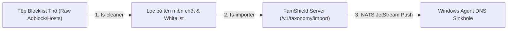

# Tài Liệu Hướng Dẫn CLI Import Danh Mục & Phân Loại Tên Miền (FamShield Taxonomy & Category Importer)

Tài liệu này hướng dẫn chi tiết cách sử dụng bộ công cụ dòng lệnh (CLI Tools) của **FamShield Server** để nạp danh mục trang web, làm sạch danh sách đen (Blacklist Cleaner), và phân loại tên miền tự động (AI Classifier) xuống máy trạm Windows Agent.

---

## 1. Tổng Quan Kiến Trúc & Cơ Chế Đồng Bộ

Hệ thống lọc web và phân loại của FamShield hoạt động theo kiến trúc 3 cấp độ chặt chẽ:

```
┌─────────────────────────────────────────────────────────────────────────┐
│                       0. CORE SYSTEM WHITELIST                          │
│        (Ưu tiên số 1: Luôn bỏ qua lọc - gov.vn, vnedu, google...)       │
└────────────────────────────────────┬────────────────────────────────────┘
                                     ▼
┌─────────────────────────────────────────────────────────────────────────┐
│                    1. GLOBAL DOMAIN TAXONOMY                            │
│  (Cơ sở tri thức toàn cầu: adult, gambling, violence, social, gaming...)│
└────────────────────────────────────┬────────────────────────────────────┘
                                     ▼
┌─────────────────────────────────────────────────────────────────────────┐
│                    2. TENANT WEB FILTER POLICY                          │
│  (Chính sách riêng từng gia đình: CategoryCustomDomains & Overrides)     │
└────────────────────────────────────┬────────────────────────────────────┘
                                     ▼
┌─────────────────────────────────────────────────────────────────────────┐
│                    3. WINDOWS AGENT SINKHOLE                            │
│    (Đẩy tức thì qua NATS JetStream & SQLite Cache - Chặn tại Driver)     │
└─────────────────────────────────────────────────────────────────────────┘
```

1. **Core Whitelist (Bảo vệ tối cao)**: Các dịch vụ trọng yếu (chính phủ, giáo dục, ngân hàng, dịch vụ xác thực) không bao giờ bị chặn nhầm.
2. **Global Taxonomy (`GlobalDomainClassification`)**: Cơ sở dữ liệu phân loại toàn cầu do Admin và AI gán nhãn.
3. **Chính sách gia đình (`WebFilterPolicy`)**: Phụ huynh bật/tắt chặn theo danh mục (`BlockAdult`, `BlockGambling`, `BlockSocial`, `BlockGaming`...) và thêm các tên miền riêng (`CategoryCustomDomains`).
4. **Máy trạm con (`Windows Agent`)**: Nhận danh sách chặn đã gộp và biên dịch, lưu vào SQLite cục bộ và nạp vào DNS Sinkhole. Ngay cả khi ngắt kết nối mạng internet, việc chặn vẫn duy trì 100%.

---

## 2. Bộ Công Cụ CLI Chuyên Dụng

FamShield cung cấp các công cụ phục vụ nạp danh mục và quản trị:

| Công cụ | Vị trí / Lệnh thực thi | Mục đích sử dụng chính |
| :--- | :--- | :--- |
| **`famshield-importer` (Standalone Tool)** | `tools/famshield-importer/` (hoặc binary độc lập `./bin/famshield-importer`) | **Công cụ độc lập Zero-Dependency dành cho Quản trị viên/DevOps**: Nạp danh mục từ file, URL Threat Feed trực tiếp, Pipe STDIN, kiểm tra domain (`-check`), tích hợp API Key, không phụ thuộc codebase server. |
| **`cmd/importer` (Internal CLI)** | `server/cmd/importer` | Phiên bản tích hợp bên trong module server dành cho phát triển nội bộ. |
| **`cmd/cleaner`** | `server/cmd/cleaner` | **Làm sạch danh sách thô**: Bỏ tên miền chết (DNS check), loại trừ danh sách trắng (Whitelist), chuẩn hóa cú pháp AdGuard/Hosts. |
| **`cmd/classifier`** | `server/cmd/classifier` | **Phân loại AI tự động**: Cào Title/Meta website và dùng Google Gemini / OpenAI ChatGPT phân loại các tên miền chưa rõ danh mục. |

---

## 3. Hướng Dẫn Sử Dụng Standalone Importer Tool (`tools/famshield-importer`)

Công cụ `tools/famshield-importer` được tách thành **công cụ nhị phân độc lập (Standalone Zero-Dependency CLI)**. Quản trị viên có thể biên dịch thành 1 file binary duy nhất và sao chép mang đi sử dụng trên bất kỳ máy trạm (macOS, Linux, Windows) mà không cần cài đặt database hay kéo source code server.

### Biên dịch nhị phân nhanh:
```bash
cd tools/famshield-importer
./build.sh
# File thực thi nằm tại: tools/famshield-importer/bin/famshield-importer
```

### Cú pháp lệnh:
```bash
./bin/famshield-importer -input <tệp_dữ_liệu> -category <tên_danh_mục> [tùy chọn]
# Hoặc tải trực tiếp từ URL Threat Feed từ xa:
./bin/famshield-importer -url <link_http_threat_feed> -category <tên_danh_mục> [tùy chọn]
```

### Các tính năng nâng cao của Standalone Tool:
1. **Nạp từ URL từ xa**: `-url https://raw.githubusercontent.com/.../blocklist.txt` (tự động stream và parse không cần tải file về đĩa trước).
2. **Đọc qua STDIN Unix Pipe**: `curl -s https://... | ./bin/famshield-importer -input - -category adult`.
3. **Tra cứu phân loại (`-check`)**: `./bin/famshield-importer -check facebook.com -server https://api.famshield.cloud`.
4. **Kiểm tra danh sách chờ (`-pending`)**: `./bin/famshield-importer -pending -server https://api.famshield.cloud`.
5. **Xác thực API Key**: Tự động nhận diện cờ `-api-key` hoặc biến môi trường `FAMSHIELD_API_KEY`.

### Các tham số hỗ trợ:
| Tham số | Giá trị mặc định | Giải thích |
| :--- | :--- | :--- |
| `-input` | *(Bắt buộc)* | Đường dẫn tới tệp văn bản chứa tên miền. |
| `-category` | `social` | Tên danh mục: `adult`, `gambling`, `violence`, `social`, `gaming`, `education`, hoặc danh mục tùy biến. |
| `-target` | `both` | Mục tiêu nạp: `taxonomy` (chỉ nạp toàn cầu), `policy` (chỉ nạp vào chính sách máy con), hoặc `both` (cả hai). |
| `-server` | `http://localhost:8080` | URL máy chủ FamShield Server. |
| `-tenant` | `tenant-default` | Mã Tenant ID của gia đình cần áp dụng chính sách. |
| `-source` | `cli_bulk_import` | Nhãn nguồn gốc dữ liệu ghi vào nhật ký. |
| `-batch` | `500` | Số lượng tên miền gửi trong mỗi request HTTP. |
| `-api-key` | `FAMSHIELD_API_KEY` | Khóa bí mật Admin API Key để xác thực khi máy chủ bật bảo mật. |
| `-skip-whitelist` | `false` | Bỏ qua việc lọc qua Whitelist an toàn cốt lõi. |
| `-dry-run` | `false` | Chạy thử nghiệm để kiểm đếm số lượng, không lưu vào database. |

### Các định dạng tệp hỗ trợ:
Công cụ tự động nhận diện và xử lý tất cả các định dạng sau trong cùng một tệp:
1. **Tên miền thuần (Plain Domain)**:
   ```text
   tiktok.com
   m.tiktok.com
   facebook.com
   ```
2. **Cú pháp Adblock / AdGuard (`||domain^`)**:
   ```text
   ||bet365.com^
   ||kubet.com^$third-party
   ```
3. **Cú pháp tệp Hosts (`0.0.0.0` hoặc `127.0.0.1`)**:
   ```text
   0.0.0.0 xvideos.com
   127.0.0.1 xnxx.com
   ```
4. **Định dạng CSV / URL đầy đủ**:
   ```text
   https://fun88viet.tv/login,gambling,trang cá cược bóng đá
   roblox.com,gaming
   ```

---

## 4. Các Ví Dụ Thực Tế Phổ Biến

### Ví dụ 1: Nạp 5.000 trang web Cờ bạc & Cá cược
Khi bạn tải về một danh sách các trang cá độ bóng đá, casino trực tuyến:
```bash
go run ./cmd/importer \
  -input ./data/gambling_vn.txt \
  -category gambling \
  -server http://localhost:8080 \
  -target both
```
> **Kết quả:** Hệ thống lưu toàn bộ 5.000 tên miền vào Global Taxonomy với mức độ độc hại (`safety_score: 95`), đồng thời cập nhật vào `category_custom_domains["gambling"]` của chính sách. Máy trạm con của trẻ lập tức nhận tín hiệu qua NATS JetStream và chặn truy cập ngay lập tức.

---

### Ví dụ 2: Nạp danh sách Game trực tuyến cho một gia đình cụ thể
Áp dụng danh sách game cho riêng gia đình có Tenant ID `tenant-usr-1a2b3c`:
```bash
go run ./cmd/importer \
  -input ./data/game_servers.txt \
  -category gaming \
  -tenant tenant-usr-1a2b3c \
  -target policy
```

---

### Ví dụ 3: Nạp danh sách website Giáo dục (Whitelist / An toàn)
Nạp các trang học trực tuyến vào danh mục `education` chỉ ở cấp Taxonomy toàn cầu:
```bash
go run ./cmd/importer \
  -input ./data/vietnam_edu_sites.txt \
  -category education \
  -target taxonomy
```

---

## 5. Quy Trình Phối Hợp Hoàn Chỉnh: `cleaner` ➔ `importer` ➔ `agent`

Để đảm bảo hiệu năng và không chặn nhầm website quan trọng, quy trình chuẩn khuyến nghị gồm 2 bước:



### Bước 1: Làm sạch tệp thô bằng `fs-cleaner`
```bash
# Quét 150 luồng DNS song song để loại bỏ các tên miền đã sập (dead domains)
go run ./cmd/cleaner \
  -input raw_community_blocklist.txt \
  -output clean_active_blocklist.txt \
  -server http://localhost:8080 \
  -concurrency 150
```

### Bước 2: Nạp tệp đã làm sạch vào danh mục cụ thể bằng `fs-importer`
```bash
go run ./cmd/importer \
  -input clean_active_blocklist.txt \
  -category adult \
  -target both
```

---

## 6. Phân Loại Tự Động Bằng Trí Tuệ Nhân Tạo (`fs-classifier`)

Đối với các tên miền trẻ em đã truy cập nhưng chưa có trong danh mục định sẵn:

```bash
# Chạy worker AI tự động cào trang và phân loại với Google Gemini
export GEMINI_API_KEY="AIzaSy..."
go run ./cmd/classifier \
  -server http://localhost:8080 \
  -model gemini-1.5-flash \
  -batch-size 15 \
  -concurrency 25

# Hoặc phân loại ngay 1 tệp domain chưa rõ loại:
go run ./cmd/classifier \
  -input unclassified_domains.txt \
  -gemini-key "AIzaSy..."
```

---

## 7. Cơ Chế Bảo Mật API Key Khi Quản Trị Viên / Dev Đẩy Từ Xa

Khi triển khai FamShield Server lên môi trường VPS / Cloud (như AWS, DigitalOcean, Hetzner), các endpoint nạp dữ liệu cần được bảo vệ để ngăn chặn kẻ xấu đầu độc dữ liệu (Taxonomy Poisoning) hoặc tự ý thay đổi bộ lọc trên máy trạm trẻ em.

### Cấu hình phía Server:
Thiết lập biến môi trường `ADMIN_API_KEY` trong tệp `.env` máy chủ:
```bash
ADMIN_API_KEY=fsk_live_prod_super_secret_key_123456
```
*(Nếu `ADMIN_API_KEY` để trống, Server hoạt động ở chế độ Local Dev không yêu cầu xác thực)*.

### Cách thức đẩy dữ liệu từ máy Dev / CI-CD:
Có 2 cách truyền API Key từ máy trạm của lập trình viên:

#### Cách 1: Thiết lập biến môi trường cục bộ (Khuyến nghị)
```bash
export FAMSHIELD_API_KEY="fsk_live_prod_super_secret_key_123456"

# Lệnh tự động nhận diện FAMSHIELD_API_KEY mà không cần gõ lại cờ:
go run ./cmd/importer -input gambling.txt -category gambling -server https://server.famshield.cloud
```

#### Cách 2: Truyền trực tiếp qua cờ `-api-key`
```bash
go run ./cmd/importer \
  -input social.txt \
  -category social \
  -server https://server.famshield.cloud \
  -api-key "fsk_live_prod_super_secret_key_123456"
```

> **Ghi chú cơ chế xác thực kép (Dual Auth):**
> Máy chủ hỗ trợ nhận diện quyền Quản trị qua cả 3 hình thức:
> 1. Header `X-API-Key: <ADMIN_API_KEY>` (chuẩn CLI / CI-CD automation).
> 2. Header `Authorization: Bearer <ADMIN_API_KEY>` (tương thích các reverse proxy / API gateway).
> 3. Dynamic API Keys sinh từ cơ sở dữ liệu (`fsk_live_...`).
> 4. JWT Token đăng nhập từ Web Console (dành cho phụ huynh thao tác trên UI).

---

## 8. Quản Lý Khóa API & Kết Nối Hệ Thống Bên Ngoài (M2M / Microservices)

Để phục vụ vận hành dài hạn và kết nối an toàn với các hệ thống bên thứ ba (Hệ thống quản lý trường học MIS, Bot giám sát, Script nạp danh mục, CI/CD), FamShield Server tích hợp hệ thống quản lý Khóa API cấp doanh nghiệp:

### 1. Nguyên Tắc Bảo Mật Cốt Lõi:
* **Định dạng khóa**: Tiền tố nhận diện `fsk_live_` + chuỗi ngẫu nhiên 32 ký tự hex (Entropy an toàn tuyệt đối).
* **Lưu trữ một chiều (Zero-Knowledge Storage)**: Cơ sở dữ liệu **chỉ lưu mã băm SHA-256** của khóa. Máy chủ không lưu khóa gốc, đảm bảo an toàn ngay cả khi database bị lộ.
* **Hiển thị 1 lần duy nhất**: Khóa đầy đủ chỉ hiển thị một lần duy nhất lúc tạo thành công. Sau đó UI chỉ hiển thị tiền tố rút gọn (ví dụ: `fsk_live_a1b2c3...`).
* **Thu hồi tức thì (Instant Revocation)**: Khi nghi ngờ rò rỉ, quản trị viên có thể vô hiệu hóa khóa ngay lập tức với 1 chạm.

### 2. Quản Lý Trực Quan Trên Web Console:
Trên thanh điều hướng Web Console, nhấn nút **"Khóa API"** (biểu tượng chiếc chìa khóa):
1. Nhấn **"Tạo Khóa Mới"**, nhập tên gợi nhớ (ví dụ: *"Máy Dev Laptop Tu"*, *"Cronjob AdGuard Sync"*) và thời hạn hiệu lực (30 ngày, 90 ngày, 1 năm, hoặc vĩnh viễn).
2. Sao chép chuỗi khóa bí mật `fsk_live_...` và lưu vào biến môi trường máy dev.
3. Xem danh sách các khóa đã cấp, thời điểm tạo, lần sử dụng cuối, và trạng thái hoạt động.

### 3. Các API Quản Trị Khóa Dành Cho Tích Hợp:

#### A. Cấp Khóa Mới: `POST /v1/admin/api-keys`
```bash
curl -X POST "http://localhost:8080/v1/admin/api-keys" \
  -H "X-API-Key: master_admin_key" \
  -H "Content-Type: application/json" \
  -d '{
    "name": "Dev Importer CLI",
    "role": "admin",
    "scopes": ["*"],
    "expires_in_days": 90
  }'
```

#### B. Xem Danh Sách Khóa: `GET /v1/admin/api-keys`
```bash
curl "http://localhost:8080/v1/admin/api-keys" \
  -H "X-API-Key: master_admin_key"
```

#### C. Thu Hồi Khóa: `DELETE /v1/admin/api-keys?id={key_id}`
```bash
curl -X DELETE "http://localhost:8080/v1/admin/api-keys?id=key-1740000000" \
  -H "X-API-Key: master_admin_key"
```

---

## 9. Chi Tiết API Dành Cho Tích Hợp (REST Endpoints)

Nếu bạn muốn tích hợp tự động vào hệ thống CI/CD hoặc kịch bản Bash/Python:

### Endpoint: `POST /v1/taxonomy/import`
**Headers:** `Content-Type: application/json`

**Body mẫu:**
```json
{
  "category": "gambling",
  "domains": [
    "bet365.com",
    "1xbet.com",
    "w88vn.top"
  ],
  "target": "both",
  "tenant_id": "tenant-default",
  "source": "ci_pipeline"
}
```

**Phản hồi thành công (HTTP 200 OK):**
```json
{
  "status": "success",
  "category": "gambling",
  "imported_count": 3,
  "target": "both",
  "policy_updated": true,
  "tenant_id": "tenant-default"
}
```

### Endpoint tra cứu: `GET /v1/filter/resolve`
Kiểm tra hiệu lực phân loại và quyết định chặn/cho phép đối với 1 tên miền:
```bash
curl "http://localhost:8080/v1/filter/resolve?tenant_id=tenant-default&domain=tiktok.com"
```
**Kết quả:**
```json
{
  "domain": "tiktok.com",
  "tenant_id": "tenant-default",
  "action": "block",
  "effective_category": "social",
  "source": "tenant_category_rule",
  "reason": "Category 'social' is blocked by guardian"
}
```

---

## 9. Bảng Mã Danh Mục Chuẩn Hệ Thống

| Mã danh mục (`category`) | Tên hiển thị tiếng Việt | Điểm an toàn (`SafetyScore`) | Hành vi mặc định khi bật chặn |
| :--- | :--- | :--- | :--- |
| `adult` | Nội dung người lớn (18+) | 95 (Độc hại cao) | Chặn DNS NXDOMAIN tức thì |
| `gambling` | Cờ bạc & Cá cược | 95 (Độc hại cao) | Chặn DNS NXDOMAIN tức thì |
| `violence` | Bạo lực & Ghê rợn | 95 (Độc hại cao) | Chặn DNS NXDOMAIN tức thì |
| `social` | Mạng xã hội & Giải trí | 50 (Cân nhắc) | Chặn hoặc giới hạn theo giờ học |
| `gaming` | Trò chơi trực tuyến | 50 (Cân nhắc) | Chặn hoặc giới hạn theo giờ học |
| `education` | Giáo dục & Học tập | 0 (An toàn) | Luôn ưu tiên cho phép |
| `utilities` | Công cụ & Tiện ích | 10 (An toàn) | Cho phép truy cập bình thường |
| `custom` | Danh mục phụ huynh tạo riêng | Tùy biến | Phụ huynh toàn quyền điều khiển |
